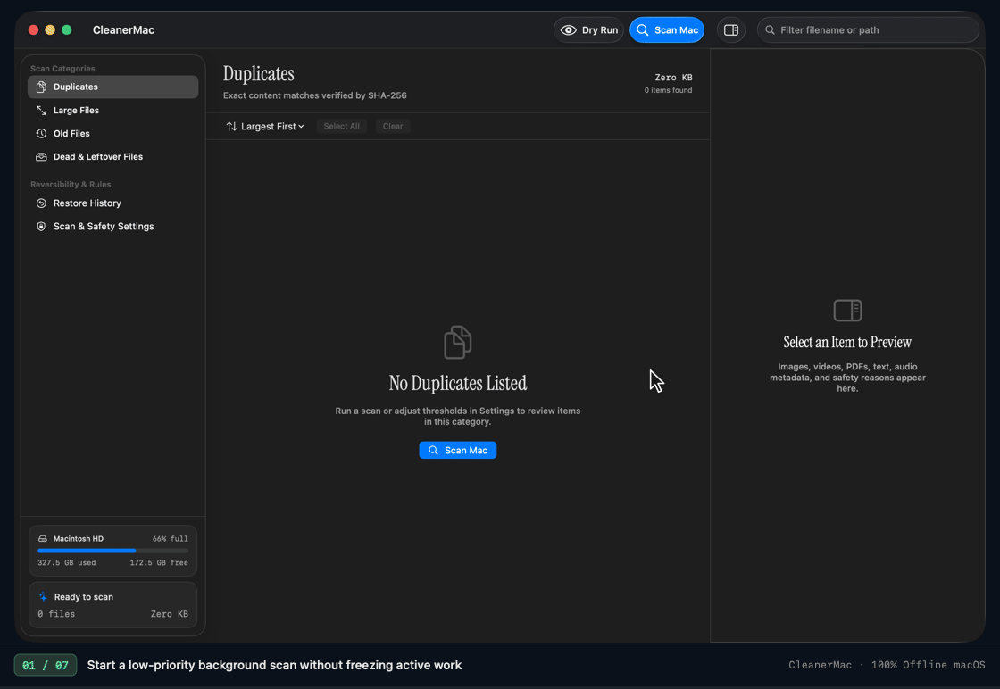
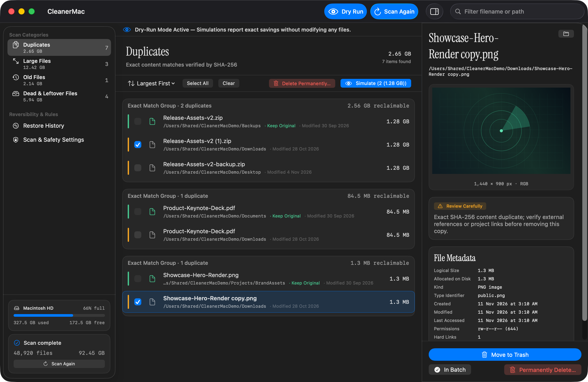
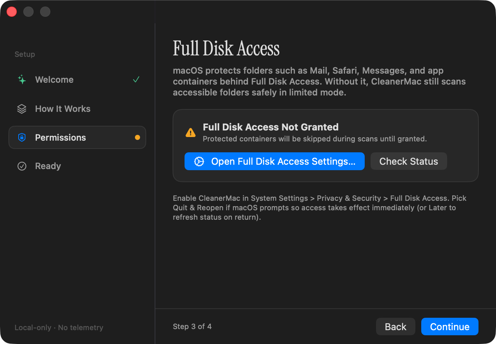

# CleanerMac

**CleanerMac** is a native, local-only macOS disk-hygiene utility written in Swift 6 and SwiftUI for macOS 14+ on Apple Silicon (`arm64` only). It finds duplicates, oversized files, stale untouched files, and dead leftovers (orphaned app data, caches, broken downloads, empty folders) using a background scanner, live multi-type preview inspector, Trash-first reversibility, and strict protected-path safety guards.



*End-to-end walkthrough (v2.0): live background scan & disk capacity HUD, SHA-256 duplicate groups with `Keep Original` protection and live preview inspector, saved scan snapshot banners with live `Re-verify` staleness guard, large files, categorized dead leftovers, and non-destructive Dry-Run simulation.*

<details>
<summary>High-resolution workspace screenshot (static retina view)</summary>



</details>

---

## Installing CleanerMac

Download `CleanerMac-macOS-arm64.zip` from [GitHub Releases](https://github.com/Anubhx/cleaner-mac/releases), unzip it, and drag `CleanerMac.app` into `/Applications`.

1. **First-launch Gatekeeper warning:** macOS shows a Gatekeeper warning on first launch because CleanerMac uses local ad-hoc signing (`codesign --sign -`) and is not notarized — as a free, open-source project, it does not use a paid Apple Developer ID certificate.
2. **Open it anyway (one-time step):** Right-click (or Control-click) `CleanerMac.app` and choose **Open**, then click **Open** again in the dialog — this only needs to be done once. *(On macOS 15 Sequoia or newer, if no **Open** button appears in that dialog, click **Done**, open **System Settings -> Privacy & Security -> Security**, and click **Open Anyway**.)*
3. **Alternative if that doesn't work:** Run `xattr -cr /path/to/CleanerMac.app` in Terminal to strip the quarantine flag (for example, `xattr -cr /Applications/CleanerMac.app`).

<details>
<summary>Verify SHA-256 checksum, build from source, and Full Disk Access setup</summary>

### Verify Release Checksum

If `SHA256SUMS.txt` is attached to the release, verify the archive before opening:

```bash
shasum -a 256 -c SHA256SUMS.txt
```

### Build & Install from Source (Zero Gatekeeper Warnings)

Building locally works with standalone Apple Command Line Tools (`xcode-select --install`, no full Xcode installation required) and produces an unquarantined `.app` bundle that opens immediately without Gatekeeper warnings:

```bash
git clone https://github.com/Anubhx/cleaner-mac.git
cd cleaner-mac
./scripts/run-tests.sh
./scripts/package-app.sh
cp -R dist/CleanerMac.app /Applications/
open /Applications/CleanerMac.app
```

> `./scripts/run-tests.sh` works cleanly on both full Xcode installations and standalone Apple Command Line Tools (`/Library/Developer/CommandLineTools`).

Alternatively, run directly without packaging:

```bash
swift run CleanerApp
```

### Full Disk Access & Updates Note

- To inspect protected user containers (`~/Library/Containers`, Mail/Safari caches), grant Terminal (when running via `swift run`) or `CleanerMac.app` **Full Disk Access** in **System Settings -> Privacy & Security -> Full Disk Access**. If macOS prompts **Quit & Reopen** vs **Later**, choose **Quit & Reopen** so the OS applies the permission to the running process immediately.
- Even with Full Disk Access granted, [`SafetyGuard`](Sources/CleanerCore/Safety/SafetyGuard.swift) strictly blocks OS system volumes (`/System`, `/Library`, `/usr`, `/bin`, `/sbin`) and other user home directories.
- Because ad-hoc builds anchor macOS TCC permissions to the binary's `cdhash`, permissions persist across restarts of the same version, but you may need to toggle CleanerMac off/on in **Full Disk Access** once after upgrading to a newer build.



*First-launch Permissions setup with direct System Settings link, live status check, and limited-mode fallback.*

</details>

---

## Core Capabilities

- **Four Focused Scan Categories**
  - **Duplicates:** Multi-stage detection (`size bucketing -> head/tail 4 KB digest -> partial sample -> full streaming SHA-256`) with hard-link `(st_dev, st_ino)` deduplication and automatic **Keep Original** protection on the canonical copy.
  - **Large Files:** Configurable size threshold across your chosen roots and non-sensitive app containers (`APFS` physical allocated and logical sizes displayed, accurately handling sparse virtual disks).
  - **Old Files:** Configurable inactivity threshold measured by **Last Accessed or Modified** (or **Last Modified Only**).
  - **Dead & Leftover Files:** Orphaned app data verified via dotted bundle-ID lineage, stale (`>= 30 days`) and heavy active (`>= 50 MB`) third-party `~/Library/Caches`, rebuildable developer/package caches (`.npm/_cacache`, `.npm/_npx`, `.gradle/caches`, `.pnpm-store`, `.bun`, `.cache`, `Xcode DerivedData`, `iOS DeviceSupport`), partial downloads past 24 hours, and empty directories.
- **Live Volume Capacity & Background Scan HUD**
  - Sidebar displays real macOS volume usage (`used`, `free`, percentage full) alongside live `.utility`-priority background scan progress with **Pause**, **Resume**, and **Cancel**.
- **All-Type Live Preview Inspector**
  - Inline preview support for **Images**, **Video** (poster frame, codec, resolution, duration), **PDF** (`PDFView`), **Text & Code** (with automatic `256 KB` truncation protection for huge logs), **Audio** (metadata & local playback preview), plus a detailed filesystem **Metadata & Risk Panel** fallback for any file type.
- **Safety-First Deletion & Undo History**
  - **Move to Trash by default** via `FileManager.trashItem`, saving verified Trash inode receipts in **Restore History** for one-click safe restoration.
  - **Permanent deletion** bypasses Trash only after entering a secondary confirmation sheet with explicit checkbox acknowledgment.
  - **Dry-Run Mode:** Simulates cleanup batches, reports projected savings, and surfaces blocked protected paths with zero disk mutations.
- **Responsive Background Scanning**
  - Runs at low `.utility` priority with frontier checkpointing for **Pause**, **Resume**, and **Cancel** while streaming results into the UI.
- **Editorial Translucent Native Design**
  - Styled around Apple HIG guidelines using **Instrument Serif** (SIL OFL 1.1) display headings, **SF Pro** / **SF Mono** metrics, `.ultraThinMaterial` / `.thinMaterial` / `.regularMaterial` surfaces, **zero emoji**, Light & Dark Mode, Dynamic Type, keyboard navigation, and VoiceOver actions.

---

## Requirements & Privacy Guarantee

- **OS:** macOS 14.0 (Sonoma) or newer (Apple Silicon / `arm64` only)
- **Toolchain:** Swift 6.0+ (`Xcode 16+` or standalone Apple Command Line Tools)
- **Privacy:** 100% offline. **Zero network requests, zero analytics, zero telemetry.**

---

## Architecture Overview

CleanerMac separates domain policy, filesystem I/O, file previewing, and UI cleanly into five Swift Package targets:

```
CleanerApp
 └── wires concrete actors into ──> CleanerUI (SwiftUI + Design System)
       ├── imports ──> CleanerPreview (AVFoundation, PDFKit, ImageIO, QuickLook)
       └── imports ──> CleanerCore (Pure domain models, SafetyGuard, RiskEvaluator, DeletionPlanner)
CleanerSystem
 └── imports ──> CleanerCore (Background frontier walker, SHA-256 pipeline, Trash executor, History store)
```

Detailed documents:
- [Architecture Overview](docs/ARCHITECTURE.md)
- [Design System Specification](docs/DESIGN_SYSTEM.md)
- [Safety & Protected-Path Rules](docs/SAFETY_RULES.md)
- [Test Plan & TDD Matrix](docs/TEST_PLAN.md)
- [Security Policy](SECURITY.md)

---

## Keyboard Shortcuts

| Action | Shortcut |
| :--- | :--- |
| Start Full Scan / Scan Again | `Cmd+R` |
| Pause / Resume Scan | `Cmd+Shift+P` |
| Cancel Scan | `Cmd+.` |
| Toggle Dry-Run Mode | `Cmd+Shift+D` |
| Toggle Preview Inspector | `Cmd+Opt+I` |
| Multi-select Rows | `Click`, `Cmd+Click`, `Shift+Click`, `Up`/`Down` Arrows |
| Toggle Checked State on Highlighted Rows | `Space` |
| Select All Eligible in Active Category | `Cmd+A` (list focus) or `Cmd+Opt+A` |
| Move Checked Items to Trash | `Cmd+Delete` |
| Permanently Delete Checked Items… | `Cmd+Shift+Delete` |

---

## Contributing

Contributions are welcome under our TDD and design standards. Read [CONTRIBUTING.md](CONTRIBUTING.md) and our [Code of Conduct](CODE_OF_CONDUCT.md) before opening a pull request.

---

## Acknowledgments

CleanerMac is original Swift software whose scanning heuristics and safety defense-in-depth drew inspiration from two open-source macOS utilities studied during architecture design:

- **[guhcostan/mac-cleaner-cli](https://github.com/guhcostan/mac-cleaner-cli)** — Inspired conservative risk categorization (never auto-selecting ambiguous user files), Dry-Run workflow clarity, and the 24-hour grace window on active browser downloads.
- **[iliyami/MacSai](https://github.com/iliyami/MacSai)** — Inspired APFS firmlink canonicalization, symlink TOCTOU target validation, dotted bundle-ID lineage with helper-suffix stripping and empty-app-index fail-safes, `(st_dev, st_ino)` hard-link tracking, and inode-verified Trash restore receipts.

Bundled editorial typography uses **Instrument Serif**, licensed under the [SIL Open Font License 1.1](Sources/CleanerUI/Resources/Fonts/OFL.txt).

---

## License

Licensed under the MIT License. See [LICENSE](LICENSE) for full text.
